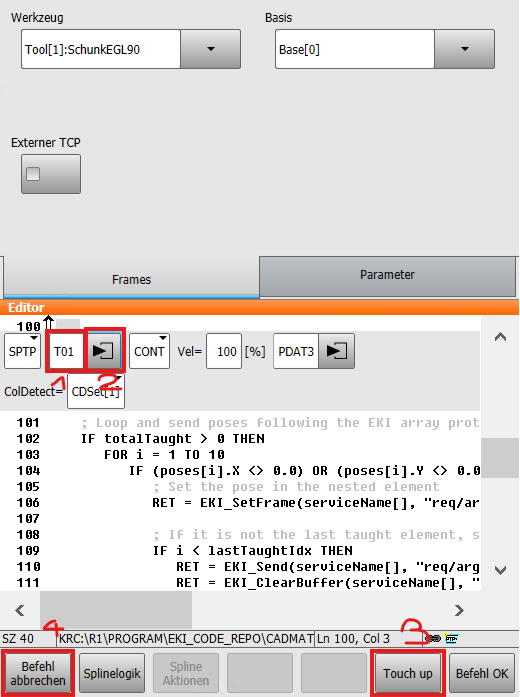
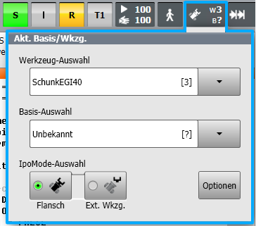

# TeachGrasps - CADMatch Griffposen-Einlern-Utility

## Kurzübersicht

Eine detaillierte konzeptionelle Erklärung zum Griffposen-Einlernen und den entsprechenden Anwendungsfällen finden Sie im [Roboception Grasp Teaching Tutorial](https://tutorials.roboception.de/rc_cadmatch/grasp_teaching.html).

Mit dem `TeachGrasps`-Utility können Sie Griffposen an einem CADMatch-Objekt mithilfe des physischen Roboters und Greifers einlernen.

Dies ist besonders nützlich, wenn:
- Der physische Greifer nicht präzise modelliert werden kann.
- Das Zielbauteil komplex ist und das Positionieren eines Griffs über das Web-Interface schwierig ist.

> [!WARNING]
> **Führen Sie dieses Programm nicht im Auslieferungszustand aus.** Sie müssen zuerst die Griffposen am Roboter einlernen.

### Allgemeiner Ablauf:
1. **Stellen Sie sicher, dass das physische Bauteil gut erkannt wird und isoliert liegt.** Es wird dringend empfohlen, die Erkennung auf der Seite "Try Out CADMatch" der Web-GUI zu überprüfen. Wenn keine Isolierung gewährleistet werden kann, schränken Sie den Erkennungsbereich mithilfe von `TeachingRoi` in der SRC-Datei auf einen bestimmten 3D-Arbeitsraum (ROI) ein.
2. **Lernen Sie die Posen** `T01` bis `T10` mithilfe des Bediengeräts (SmartPAD) oder WorkVisual (wie unten beschrieben) ein. Alle eingelernten (später ungleich Null) Posen werden auf dem CADMatch-Template als `taught_grasp_XXX` registriert.
3. **Bewegen Sie den Roboter vollständig aus dem Bildbereich** (Sichtfeld der Kamera), ohne das Bauteil zu berühren oder zu verschieben.
4. **Starten Sie das Programm.** Der Roboter wird sich nicht bewegen. Das Zielbauteil wird mehrfach erkannt, die Posen gemittelt und die entsprechenden Griffposen gespeichert.

---

## Detaillierte Anweisungen

### So definieren Sie die Posen (T01 bis T10)

Sie können die Griffposen auf zwei Arten definieren:

#### Methode A: KUKA SmartPAD-Workaround (Touch Up)
So zeichnen Sie physische TCP-Posen auf, ohne tatsächliche Roboterbewegungsbefehle in das Programm einzufügen:

0. **Fügen Sie einen neuen Bewegungsbefehl** an einer beliebigen Zeile in der SRC-Datei ein.
1. **Benennen Sie den Punkt** in `T01` bis `T10` um.
2. **Über die Parameter-Erweiterung (Dreieck-Symbol)** die Detaileinstellungen des Inline-Formulars öffnen und das aktive Werkzeug (Tool-Nummer) auswählen. *Hinweis: Die Werkzeugauswahl in der oberen Statuszeile des SmartPADs wird bei dieser Methode ignoriert.*
3. **Drücken Sie Touch Up**, um die aktuellen TCP-Koordinaten in der DAT-Datei zu speichern, und bestätigen Sie die Überschreib-Meldung.
4. **Drücken Sie Befehl abbrechen** auf dem Inline-Formular, um den Bewegungsbefehl aus der SRC-Datei zu verwerfen. Die Koordinaten bleiben in der DAT-Datei gespeichert.

#### Methode B: Direktes Bearbeiten der DAT-Datei & WorkVisual
Sie können die Koordinaten für die Variablen `XT01` bis `XT10` auch direkt in [TeachGrasps.dat](TeachGrasps.dat) teachen/ändern oder diese über WorkVisual bearbeiten.

*Hinweis: Stellen Sie bei dieser Methode sicher, dass das richtige Werkzeug im Tool-Selector in der oberen Statuszeile des SmartPADs aktiv ist:*

---

### Greiferöffnung während des Einlernens anpassen

Das Einlernen unterschiedlicher Griffe kann unterschiedliche Greiferöffnungen erfordern.

So passen Sie die physische Greiferöffnung während des Einlernens an:
1. Tippen/Klicken Sie auf eine der Greifer-Bewegungszeilen in [TeachGrasps.src](TeachGrasps.src#L71-L76):
   - `GripperEGIMoveToAbsPos(opening_3)`
   - `GripperEGIMoveToAbsPos(opening_2)`
   - `GripperEGIMoveToAbsPos(opening_1)`
2. Führen Sie manuell nur diese eine Zeile aus, um die aktuelle Greiferöffnung zu ändern.
